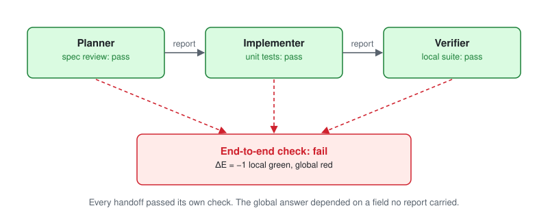

# Add LGGR checks to your agent harness

**AuthorityEffect: None.**

Every agent in a loop can pass its own check while the end-to-end answer fails. This folder shows a harness author how to catch that with the stdlib package `lggr`, using events their loop already has. Nothing here calls a model, admits an authority, or clears an obligation.



## Pick a technique

Start with [guide 00](guides/00_where_lggr_fits.md) to map your loop's objects to LGGR terms. Each guide has a picture, numbered wiring steps, the exact receipt statuses, and a runnable recipe.

| Guide | Stops this bug | Rests on | Status |
| --- | --- | --- | --- |
| [01 Report collision guard](guides/01_report_collision.md) | A handoff drops the field the next agent must decide on | `StreamingFiberMonitor` | Shipped monitor |
| [02 Authority firewall](guides/02_authority_firewall.md) | An agent loosens its own rules or signs its own pass | `BudgetPolicy`, `make_witness`, `StreamingAuditMonitor` | Shipped monitor |
| [03 Collision-guided checks](guides/03_collision_guided_checks.md) | A verifier spends its budget on checks that cannot change the verdict | `StreamingFiberMonitor` | Pattern under evaluation |
| [04 Checked memory](guides/04_checked_memory.md) | An agent acts on a note written against an old contract | `BudgetPolicy.sha256`, obligations | Pattern under evaluation |

"Pattern under evaluation" means the recipe is tested code built on shipped monitors, but its practical advantage is still being measured. The guides make no performance claim for it.

Not Python? `python -m learn.sidecar` reads [contract](HARNESS_CONTRACT.md) events as JSON lines and writes receipts back. [csharp/LggrSidecar.cs](csharp/LggrSidecar.cs) is a C# client.

## Run it

From the repository root with Python 3.10 or newer. Installing the package is unnecessary.

```console
python learn/check.py
python learn/recipes/check_selector.py
python learn/lessons/01_same_summary_different_job.py
python -m unittest tests/test_learn_path.py -v
```

`learn/check.py` replays the prepared half of all ten lessons and the four recipe demos, and prints one line each: id, receipt schema, status. Exit 0 means those statuses match. Each lesson also has a your-turn dict. Edit that dict to point the same monitor at your own field names. The test suite does not read the your-turn dict.

## The course

The ten lessons below are the reasoning behind the guides. Take them when a guide's receipt raises a question.

### How long

| Time | Lessons | You leave able to |
| --- | --- | --- |
| 20 minutes | 00, 01, 07 | Name the query, catch a report collision, and see a fiber-width ceiling |
| One afternoon | 00–09 | Wire a tool loop, a handoff, and a review cycle |
| After that | Papers listed in each lesson | Read the scoped proof that matches the receipt you just held |

The four scripts in `cookbooks/` are short demos of the same monitors.

### The ten lessons

Diagrams: [prefix vs endpoint](img/prefix_vs_endpoint.svg) for lesson 03, [three stops](img/three_stops.svg) for lesson 08.

| Lesson | Question the receipt answers |
| --- | --- |
| 00 Name the question | Is there a declared scope, report, and query yet? |
| 01 Same summary, different job | Do two states share a report and differ on the query? |
| 02 Local green is not the global question | What is `Delta_E` when the global sample is supplied from outside? |
| 03 A prefix is not an endpoint | Does the bound have to hold on the way, or only at the end? |
| 04 The review cycle | Does the cycle close, and what is the exact repair distance? |
| 05 Moving the ledger | Does the new encoding preserve repairs, and does it reflect nonrepairability? |
| 06 A boundary that holds | On this supplied table, is the report constant on the query and are the steps glued? |
| 07 Another generation on the same report | Does a new predictor that still sees only the coarse report undercut the half-spread? |
| 08 Three ways a loop stops | Which receipt is a report collision, a budget stop, or a gluing refusal? |
| 09 The pass comes from outside | Who supplied the global sample, and which obligations are still open? |

Copy `HARNESS_CONTRACT.md` if your harness is not Python. `harness_adapter.py` is one reference wiring of that contract.

### After the course

These monitors are in `lggr.streaming` and are not on the core path. Each line is the class docstring's subject, so you can open the class when a receipt from the course is too coarse for the question you actually have.

| Monitor | Subject |
| --- | --- |
| `StreamingPositiveExtensionMonitor` | Observer-fiber minimax floor and positive-extension order |
| `StreamingTransportMonitor` | Streaming chain retraction and coarse-graining |
| `StreamingPathKernelMonitor` | LGGR I / III evaluated path kernels |
| `StreamingOrganizationalGluingMonitor` | LGGR II organizational gluing and carrier mixing |
| `StreamingCoalitionalAttributionMonitor` | LGGR II Shapley attribution against a raw defect |
| `StreamingSixRoleOverlayMonitor` | LGGR III six accounting roles |
| `StreamingDefectSoundnessMonitor` | LGGR V realizable-defect soundness |
| `StreamingGramProbeMonitor` | LGGR VI Gram nullspace and adjoint probes |
| `StreamingProductRetractionMonitor` | LGGR VII product-state retraction versus a separable extension |
| `StreamingBellPolytopeMonitor` | CHSH behavior tables, visibility, negative mass |
| `StreamingDashboardAdequacyMonitor` | Dashboard collapse of a detector |
| `StreamingBaselineComparator` | Ordinary baseline arithmetic beside the audit |
| `StreamingWindowedDriftMonitor` | Sliding-window budget versus the full horizon |
| `StreamingReplayOrderMonitor` | Prefix budget when step order is permuted |
| `StreamingThresholdGovernanceMonitor` | k-of-n quorum versus a strict product |
| `StreamingCPTPTraceMonitor` | Rational channel trace residual on a supplied matrix |
| `StreamingDFAGrammarGluingMonitor` | Finite-automaton tape concatenation |
| `StreamingMayerVietorisMonitor` | A declared cover and its connecting defect |
| `StreamingSimplicialCupMonitor` | Cup product on a supplied simplex |
| `StreamingHodgeDecompositionMonitor` | Orthogonal decomposition over the rationals |

Paper 000 (*Relational Reasoning, Memory, and Embedded Knowledge*) is the reading for lesson 07 and lesson 08. Its current edition keeps scoped finite-carrier bounds and constructive memory results. This course uses that wording. Paper 002's four-role council protocol remains proposed. The glossary says where that sentence sits.
