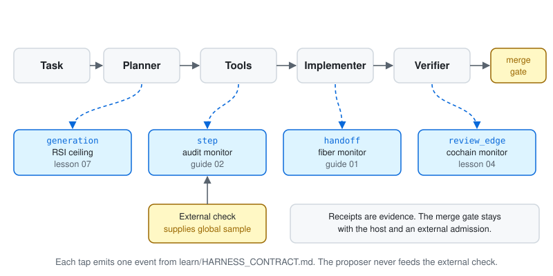

# 00 Where LGGR fits in your harness

**AuthorityEffect: None.**

LGGR does not replace your tests. It watches the seams between agents, where every local check can pass and the global answer still fails.



## Map your objects

| Your harness has | LGGR calls it | Event | Guide or lesson |
| --- | --- | --- | --- |
| A message or summary passed to the next agent | report | `handoff` | [01](01_report_collision.md) |
| The requirement that message must decide | query | `handoff` | [01](01_report_collision.md) |
| One agent action that changes tracked state | step witness | `step` | [02](02_authority_firewall.md) |
| An end-to-end test, human sign-off, or prod probe | global sample, external | `step` | [02](02_authority_firewall.md) |
| A paid check a verifier may buy | hypothesis-separating check | none, host-side | [03](03_collision_guided_checks.md) |
| Notes an agent writes for its next session | checked record | none, host-side | [04](04_checked_memory.md) |
| Agents scoring each other around a loop | review edge | `review_edge` | [lesson 04](../lessons/04_the_review_cycle.py) |
| A retry or new generation on the same summary | generation | `generation` | [lesson 07](../lessons/07_recursion_on_a_fixed_report.py) |

## Three rules that hold in every guide

1. **Name the query before you wire anything.** If you cannot say what the next stage must decide, no monitor can tell you whether the report carries it. [Lesson 00](../lessons/00_name_the_question.py) refuses to run without one.
2. **The proposer never supplies the global sample.** It comes from a check the proposing agent cannot reach.
3. **A receipt is evidence, never permission.** Every receipt says `authority_effect: "None"`. Merge, deploy, and spend stay with the host and an external admission.

## Your harness is not Python

Run the JSON-lines sidecar and talk to it from any language:

```console
python -m learn.sidecar < events.jsonl
```

The first line declares the run; each later line is one event from [HARNESS_CONTRACT.md](../HARNESS_CONTRACT.md). One receipt comes back per line. [csharp/LggrSidecar.cs](../csharp/LggrSidecar.cs) is a C# client:

```csharp
using var lggr = new LggrSidecar(repoRoot);
lggr.Send(new JsonObject { ["declare"] = declaration });
var receipt = lggr.Send(new JsonObject {
    ["event"] = "handoff", ["state_id"] = "task-b",
    ["report"] = new JsonObject { ["summary"] = "ship the etl job" },
    ["query"] = new JsonObject { ["approval_tier"] = 1 },
});
if ((string?)receipt["status"] == "REPORT_INSUFFICIENT") BlockHandoff(receipt);
```
