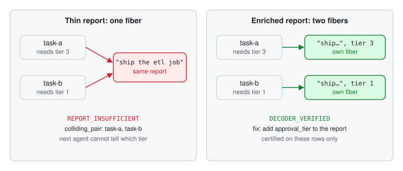

# 01 Report collision guard

**AuthorityEffect: None.** Recipe: [`recipes/collision_guard.py`](../recipes/collision_guard.py).

**The bug.** The planner sends "ship the etl job" for two tasks. One needs approval tier 3, the other tier 1. The implementer gets identical messages, so it cannot tell them apart, and both runs pass their local tests.



## Wire it in

1. Name the query each handoff must determine. Here it is `approval_tier`.
2. Create one guard per run:

   ```python
   from learn.recipes.collision_guard import HandoffGuard
   guard = HandoffGuard(run_id)
   ```

3. Call it where your loop already hands off:

   ```python
   decision = guard.check(task_id, report=message_fields, query={"approval_tier": tier})
   if not decision["allowed"]:
       block_handoff(decision["colliding_pair"])
   ```

4. Fix the schema, not the agent. Add the field the query depends on to the report: `{"summary": ..., "approval_tier": tier}`.

## What you will see

| Run | Status |
| --- | --- |
| Thin report, second handoff | `REPORT_INSUFFICIENT`, `contract_status` `OBSTRUCTED_LGGR`, `colliding_pair` names task-a and task-b |
| Enriched report | `DECODER_VERIFIED`, `COMPOSABLE_LGGG` |

```console
python learn/recipes/collision_guard.py
```

## What it does not prove

`DECODER_VERIFIED` holds for the rows you submitted. A task the run never saw can still collide.

## Go deeper

[Lesson 01](../lessons/01_same_summary_different_job.py), [lesson 06](../lessons/06_a_boundary_that_holds.py), [cookbooks/01_online_fiber_monitoring.py](../../cookbooks/01_online_fiber_monitoring.py).
