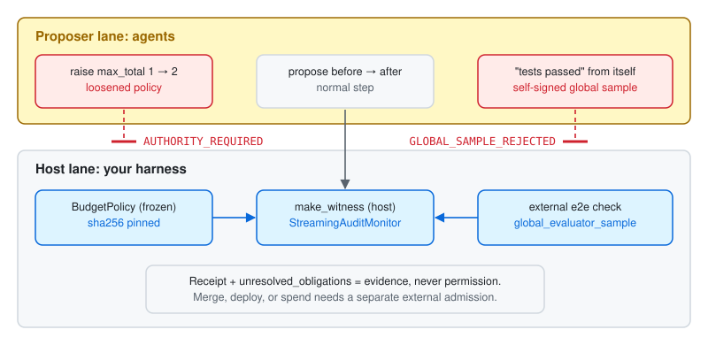
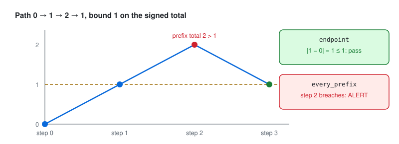

# 02 Authority firewall

**AuthorityEffect: None.** Recipe: [`recipes/authority_firewall.py`](../recipes/authority_firewall.py).

**The bug.** An agent loosens the budget it is checked against, or swaps the evaluator, then reports its own green.



## Wire it in

1. Freeze the policy in the host. It never goes in a prompt or a tool the agent can call.

   ```python
   from lggr import BudgetPolicy, StateRef
   policy = BudgetPolicy(policy_id="deploy-budget/v1", spec_id="spend-spec/v1",
                         evaluator_id="ci-local/v1", authority_id="release-owner",
                         allowed_states=(0, 1, 2), max_step=1, max_total=1,
                         query_scope="every_prefix")
   ```

2. Create one firewall per run:

   ```python
   from learn.recipes.authority_firewall import AuthorityFirewall
   fw = AuthorityFirewall(policy, baseline=StateRef("s0", 0))
   ```

3. The host builds the witness for each agent step and takes the global sample from a check the agent cannot reach:

   ```python
   receipt = fw.admit(before, after, global_sample=run_e2e(), sample_source="external")
   ```

   A witness from elsewhere goes through `fw.admit_witness(witness, ...)`. Its policy hash is compared with the frozen one.

4. Read the run's verdict, and stop on these statuses:

   ```python
   verdict = fw.verdict()
   if verdict["status"] in {"AUTHORITY_REQUIRED", "WITNESS_INCOMPLETE"}:
       escalate_to_human(verdict["findings"], verdict["unresolved_obligations"])
   ```

5. Keep `unresolved_obligations` until an external admission clears them. Never merge on a receipt.

Use `query_scope="every_prefix"` when the bound must hold after every step, not only at the end:



## What you will see

| Case | Status |
| --- | --- |
| Honest step, external sample 1 | `COMPOSITION_VERIFIED`, `composition_certified` true |
| Agent-built witness under `max_total` 2 | `AUTHORITY_REQUIRED`, finding `POLICY_MANIFEST_CHANGED` |
| Changed `evaluator_id`, `spec_id`, or `authority_id` | `AUTHORITY_REQUIRED`, findings `SEMANTIC_SCOPE_CHANGED` and `POLICY_MANIFEST_CHANGED` |
| `sample_source="proposer"` | `GLOBAL_SAMPLE_REJECTED`; the monitor never sees it |
| Step with an obligation | `WITNESS_INCOMPLETE`, obligation retained |

```console
python learn/recipes/authority_firewall.py
```

## What it does not prove

Identifiers are supplied names, not authentication. The firewall detects a changed manifest; keeping the policy out of the agent's reach is your job.

## Go deeper

[Lesson 03](../lessons/03_prefix_is_not_endpoint.py), [lesson 09](../lessons/09_the_pass_comes_from_outside.py), [cookbooks/02_streaming_budget_audit.py](../../cookbooks/02_streaming_budget_audit.py), [HARNESS_CONTRACT.md](../HARNESS_CONTRACT.md) host duties.
