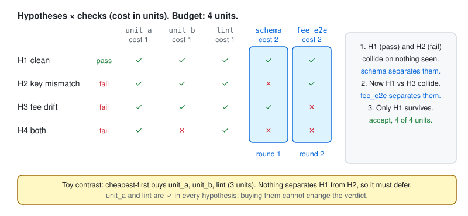

# 03 Collision-guided check selection

**AuthorityEffect: None.** Recipe: [`recipes/check_selector.py`](../recipes/check_selector.py).

> **Pattern under evaluation.** This is a simplified form of selection policy C in the LGGR/RSI swarm experiment. Whether it beats expected-information-gain selection, or a live agent choosing for itself, is that experiment's open question. Nothing here claims it does.

**The bug.** A verifier can afford 4 of 16 check units. It buys cheap checks that pass in every plausible world, runs out of budget, and either defers or accepts on hope.



## The idea in one line

While a pass hypothesis and a fail hypothesis agree on everything you have observed, your verdict is undetermined. `StreamingFiberMonitor` names such a pair. Buy a check that tells them apart.

## Wire it in

1. Enumerate a finite hypothesis set from public contracts. Each hypothesis lists the outcome of every check and the global verdict:

   ```python
   {"id": "H2-key-mismatch", "verdict": "fail",
    "outcomes": {"unit_a": True, "unit_b": True, "lint": True, "schema": False, "fee_e2e": True}}
   ```

2. Price each check: `costs = {"unit_a": 1, "unit_b": 1, "lint": 1, "schema": 2, "fee_e2e": 2}`.
3. Let the host run the loop. `run_check` executes a real check outside the proposing agents:

   ```python
   from learn.recipes.check_selector import run
   result = run(hypotheses, costs, budget=4, run_check=execute_check)
   ```

4. Act on `result["decision"]`. The shared host rule never accepts while a fail hypothesis survives:

   | Survivors | Decision |
   | --- | --- |
   | all pass | `accept` |
   | all fail | `reject` |
   | both remain when budget runs out | `defer` |
   | none | `model_mismatch`: your hypothesis set is wrong |

5. To advise a live agent instead of deciding for it, give it the `colliding_pair` and the checks that separate it, and still apply the host rule to what it bought.

## What you will see

In the demo the clean world is H1. The selector buys `schema`, then `fee_e2e`, spends 4 units, and returns `accept`. In every other world it returns `reject` within budget. A cheapest-first toy policy spends 3 units on checks that are ✓ in every hypothesis and must defer. That is an illustration on four hand-made rows, not evidence.

```console
python learn/recipes/check_selector.py
```

## What it does not prove

The rule is only as good as the hypothesis set. A world you did not enumerate shows up as `model_mismatch` at best, and at worst survives as one you did enumerate.

## Go deeper

[Lesson 07](../lessons/07_recursion_on_a_fixed_report.py) shows why another generation on the same report cannot beat the fiber ceiling, while a check that splits the fiber can. `StreamingToolAssistedFiberSplittingMonitor` in `lggr.streaming` is the monitor form of that claim.
