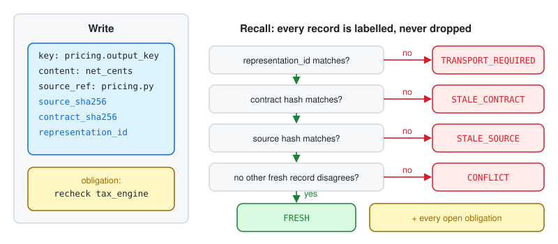

# 04 Checked memory

**AuthorityEffect: None.** Recipe: [`recipes/checked_memory.py`](../recipes/checked_memory.py).

> **Measured, inconclusive** ([swarm report](../../experiments/lggr_rsi_swarm/REPORT.md)). This mirrors memory backend D. The experiment compared it with plain persistent records (C) behind identical tools, over 30 instances × 3 draws, with a restart and then a revised contract. After the contract change, the system passed in **40 of 90** runs with checked memory and **36 of 90** with plain memory. In the paired runs, 6 passed only with D and 2 only with C (sign test p = 0.29). The direction favours checked memory, but the sample is too small to claim an effect. Nothing here claims checked memory improves completion.

**The bug.** After a restart, an agent recalls "pricing returns `net_cents`". It was true last week. Pricing now returns `net_amount_cents`, and the agent acts on the old note.



## Wire it in

1. Expose the same four tools your agents already call. Only the backend changes:

   ```python
   from learn.recipes.checked_memory import CheckedMemory
   memory = CheckedMemory.load(path) if path.exists() else CheckedMemory()
   ```

2. On write, bind the record to the source text and the contract it was read under:

   ```python
   memory.append("pricing.output_key", "net_cents",
                 source_ref="pricing.py", source_text=read("pricing.py"), policy=policy)
   memory.mark_obligation("tax_engine", "recheck tax_engine after any pricing schema change")
   ```

3. On recall, the host passes current sources and the current policy. Every hit comes back labelled:

   ```python
   hits = memory.recall("pricing", sources={"pricing.py": read("pricing.py")}, policy=policy)
   usable = [r for r in hits["records"] if r["status"] == "FRESH"]
   ```

4. Show the agent every label and every open obligation in `hits["obligations"]`. Don't filter stale records out silently: a stale label tells the agent to re-read the source.
5. `memory.save(path)` at the end of each session.

## What you will see

| Situation | Status |
| --- | --- |
| Same source, same policy, after save and load | `FRESH` |
| Source text changed | `STALE_SOURCE` |
| Policy changed, for example `max_total` 1 to 2 | `STALE_CONTRACT` |
| `representation_id` changed | `TRANSPORT_REQUIRED` |
| Two fresh records disagree on one key | `CONFLICT` on both |

The open obligation comes back on every recall.

```console
python learn/recipes/checked_memory.py
```

## What it does not prove

A stale record may still be true, and a fresh one may be wrong. The labels say only whether the bindings still match.

## Go deeper

The same pin is `POLICY_MANIFEST_CHANGED` and `REPRESENTATION_TRANSPORT_REQUIRED` in `StreamingAuditMonitor` ([guide 02](02_authority_firewall.md)). [Lesson 05](../lessons/05_moving_the_ledger.py) covers representation transport. `StreamingEqualInfoMigrationObligationMonitor` in `lggr.streaming` compares a conventional checker with the audit on a migration and a deferred obligation.
