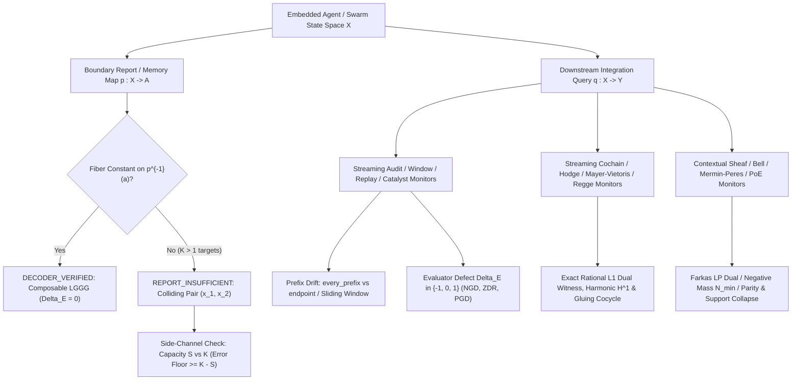

# Local Green, Global Red (LGGR) — Wiki Home

**AuthorityEffect:** `None` | **License:** Apache 2.0 | **Repository:** [dbccpage/local_green_global_red_lggr](https://github.com/dbccpage/local_green_global_red_lggr) | **Support:** [Buy Me a Coffee](https://buymeacoffee.com/ooutwire)

## New: a pre-merge gate for self-modifying agent systems

Two changes each pass review, and merged together they break the system. A check gets silently disabled, or a threshold drifts a little at a time. **[`lggr_guard`](https://github.com/dbccpage/local_green_global_red_lggr/tree/main/lggr_guard)** catches this before merge. It names the changes and the contract they jointly break, and it raises an alarm when a change does something it never declared. It is standard-library Python and makes no model calls. → **[Composition Gate](Composition-Gate)**

```text
B after A accepted   LOCAL_GREEN_GLOBAL_RED  A+B  precheck-on-by-default  UNDECLARED_EFFECT
```

---

## Start here: add LGGR checks to your agent harness

Every agent in a loop can pass its own check while the end-to-end answer fails. The [`learn/`](https://github.com/dbccpage/local_green_global_red_lggr/blob/main/learn) folder shows where to catch that in your own agentic system or harness, with one picture, a few numbered steps, and a runnable recipe per technique.

[](https://github.com/dbccpage/local_green_global_red_lggr/blob/main/learn/README.md)

| Step | Guide | Stops this bug | Status |
| --- | --- | --- | --- |
| 0 | [Where LGGR fits](https://github.com/dbccpage/local_green_global_red_lggr/blob/main/learn/guides/00_where_lggr_fits.md) | Map your loop's messages, steps, and checks to LGGR terms | Start here |
| 1 | [Report collision guard](https://github.com/dbccpage/local_green_global_red_lggr/blob/main/learn/guides/01_report_collision.md) | A handoff drops the field the next agent must decide on | Shipped monitor |
| 2 | [Authority firewall](https://github.com/dbccpage/local_green_global_red_lggr/blob/main/learn/guides/02_authority_firewall.md) | An agent loosens its own rules or signs its own pass | Shipped monitor |
| 3 | [Collision-guided checks](https://github.com/dbccpage/local_green_global_red_lggr/blob/main/learn/guides/03_collision_guided_checks.md) | A verifier spends its budget on checks that cannot change the verdict | Measured: +26.8 pts as host selector; no gain as advice to a live agent |
| 4 | [Checked memory](https://github.com/dbccpage/local_green_global_red_lggr/blob/main/learn/guides/04_checked_memory.md) | An agent acts on a note written against an old contract | Measured: inconclusive (40/90 vs 36/90) |

```console
git clone https://github.com/dbccpage/local_green_global_red_lggr.git && cd local_green_global_red_lggr
python learn/check.py                       # 10 lessons + 4 recipes, exit 0
python learn/recipes/authority_firewall.py  # one technique, end to end
```

Not Python? [`learn/sidecar.py`](https://github.com/dbccpage/local_green_global_red_lggr/blob/main/learn/sidecar.py) takes [harness contract](https://github.com/dbccpage/local_green_global_red_lggr/blob/main/learn/HARNESS_CONTRACT.md) events as JSON lines on stdin and writes receipts to stdout, and [`learn/csharp/`](https://github.com/dbccpage/local_green_global_red_lggr/blob/main/learn/csharp/LggrSidecar.cs) has a C# client. When a receipt raises a question, the [ten-lesson course](https://github.com/dbccpage/local_green_global_red_lggr/blob/main/learn/README.md#the-course) explains why it says what it says, and the papers below hold the proofs.

---

## What is in the repository

Welcome to the documentation wiki for **Local Green, Global Red (`local_green_global_red_lggr`)**. This repository provides:

1. **The `lggr` Python Witness-Audit & Online Streaming Package (`lggr/`):** Standard-library, exact rational and finite-table verifiers for report-fiber decoder/collision certification, **45 online streaming runtime monitors** (`lggr.streaming`), signed transition-history composition, weighted $\ell^1$ primal/dual repair optimality, 1-cochain closure vs. exactness classification, Hodge decomposition, Mayer-Vietoris subcomplex gluing, side-information capacity auditing, and left-inverse chain-retraction transport.
2. **The Eight-Volume LGGR Research Series (`papers/lggr_i_*` to `papers/lggr_viii_*`):** Volumes I through VIII uniting *Evaluated Path Kernels*, *Organizational Gluing*, *Six-Role Overlays*, *Completion-Relative Obstruction*, *Finite No-Recovery*, *Nonlinear Aggregation & Adjoint Probing*, *Projection Residuals & Witness Composition*, and *Online Streaming Discovery for Agentic Swarms*.
3. **The Four-Paper RSI & Bell Series (`papers/012_rsi/`):**
   - [Paper 000: Relational Reasoning, Memory, and Embedded Knowledge](RSI-Paper-000-Relational-Reasoning-Memory-and-Embedded-Knowledge) (`000_relational_reasoning_and_rsi_impossibility`)
   - [Paper 001: Contextual Prediction and Self-Certification](RSI-Paper-001-Contextual-Prediction-and-Self-Certification) (`001_contextual_prediction_and_self_certification`)
   - [Paper 002: Institutions That Can Know](RSI-Paper-002-Institutions-That-Can-Know) (`002_institutions_that_can_know`)
   - [Paper 003: Bell's Theorem as a Positive-Extension Obstruction](RSI-Paper-003-Bell-Positive-Extensions-and-Projection-Residuals) (`003_bell_positive_extensions_and_projection_residuals`)
4. **Standalone Lean 4.35.0 Formalizations (`lean4/`):** **80 machine-checked, sorry-free, zero-custom-axiom Lean 4 proofs** in the root package (`15` in `LggrVII.lean` and `65` in `LggrVIII.lean`, audited by `CheckAxioms.lean`), plus over 700 volume-scoped Lean 4 theorems across `papers/` and `papers/012_rsi/`.

---

## Architecture Overview: Agentic AI Runtime Verification



---

## Wiki Navigation

### 1. [LGGR Series: Volumes I to VIII](LGGR-Series-Volumes-I-to-VII)
- [Volume I: Evaluated Path Kernels for Composed Agent Reliability](LGGR-Volume-I-Evaluated-Path-Kernels) — Boolean defect trichotomy $\Delta_E \in \lbrace -1, 0, 1 \rbrace$, path-kernel composition discrepancy, 4-tuple dashboard adequacy, and Product-of-Experts disjoint-support collapse.
- [Volume II: Organizational Evaluator Gluing](LGGR-Volume-II-Organizational-Gluing) — Weak boundary sufficiency vs. multiplicative factorization, $k\text{-of-}n$ quorum masking, Shapley coalitional attribution, and fibered pullback squares.
- [Volume III: Six-Role Evaluator Overlay](LGGR-Volume-III-Six-Role-Overlay) — Role-indexed accounting across six system roles and net-zero cancellation masking.
- [Volume IV: Finite Presentations and Completion-Relative Obstruction](LGGR-Volume-IV-Completion-Relative-Obstruction) — Moving-witness collisions, 2-adic congruence towers ($3x + 1 \equiv 0 \pmod{2^n}$), and $R^1 \lim_{\leftarrow}$ integer lifting obstructions.
- [Volume V: Finite No-Recovery and Repair Distance](LGGR-Volume-V-Finite-No-Recovery) — Realizable soundness $\mathrm{im}(D) \cap \ker(Q) = \lbrace 0 \rbrace$, weighted $\ell^1$ repair duality, and skew-subspace norm-attainment divergence across $\ell^1, \ell^2, \ell^\infty$.
- [Volume VI: Nonlinear Aggregation, Gram Kernels, and Centered Adjoint Probing](LGGR-Volume-VI-Nonlinear-Aggregation-and-Adjoint-Probing) — Postprocessing invariance, Gram kernel identity $\ker(Q^\top Q) = \ker(Q)$, simplicial cup products, and discrete Hodge decomposition.
- [Volume VII: Projection Residuals, Positive Extensions, and Witness Composition](LGGR-Volume-VII-Projection-Residuals-and-Witness-Composition) — Synthesis of report-fiber descent, prefix vs. endpoint drift, chain-retraction reflection, observer-fiber minimax floors, and $CF$ vs. $N_{\min}$ separation.
- [Volume VIII: Online Streaming LGGG vs. LGGR Discovery for Agentic Swarms](Volume-VIII) — Complete online streaming discovery architecture across 45 runtime monitors and 65 Lean 4 theorems.

### 2. [RSI and Bell Series (`papers/012_rsi/`)](RSI-and-Bell-Series-Overview)
- [RSI Paper 000: Relational Reasoning, Memory, and Embedded Knowledge](RSI-Paper-000-Relational-Reasoning-Memory-and-Embedded-Knowledge) — Why ungrounded self-reflection loops hit an invariance ceiling without fiber-splitting evidence, and how gated persistent memory (`LiveMemory`) preserves invariants across restarts.
- [RSI Paper 001: Contextual Prediction and Self-Certification](RSI-Paper-001-Contextual-Prediction-and-Self-Certification) — Exact rational simplex LP certificates for contextuality, scalar minimax recovery, and memory-state capacity regret bounds.
- [RSI Paper 002: Institutions That Can Know](RSI-Paper-002-Institutions-That-Can-Know) — Question-preserving institutional records, the $K - S$ side-information channel capacity error floor, and why premature consensus erases witnessed disagreement in multi-agent councils.
- [RSI Paper 003: Bell's Theorem as a Positive-Extension Obstruction](RSI-Paper-003-Bell-Positive-Extensions-and-Projection-Residuals) — Four distinct obstruction classes, $CF \le (m-1)N_{\min}$, unbounded Clifford/Born $CF/N_{\min}$ families, and Mermin-Peres parity grids.

### 3. Practitioner Guides & Reference
- **[Learn: add LGGR to your harness](https://github.com/dbccpage/local_green_global_red_lggr/blob/main/learn/README.md)**: Step-by-step guides 00–04, runnable recipes, diagrams, and the JSON-lines sidecar. Start here if you build agents.
- **[Online LGGG vs. LGGR Discovery for Agentic Swarms](Online-LGGG-vs-LGGR-Discovery-for-Agentic-Swarms)** — Practical guide for hooking streaming runtime monitors into live agent handoffs, tool trajectories, and cyclic topologies.
- **[Positive Extensions and Projection Residuals](Positive-Extensions-and-Projection-Residuals)** — Four distinct obstruction questions, $CF$ vs. $N_{\min}$ separation, and observer-fiber minimax error floors.
- **[Lean 4 Formalizations](Lean-4-Formalizations)** — Complete inventory of all 65 theorems in `lean4/LggrVIII.lean` and 15 theorems in `lean4/LggrVII.lean`.
- **[Python API and CLI Reference](Python-API-and-CLI-Reference)** — Reference for `python -m lggr`, `lggr_witness_audit.pyz`, all 45 `lggr.streaming` monitors, and practitioner cookbooks.

---

Support this research: [Buy Me a Coffee](https://buymeacoffee.com/ooutwire).
